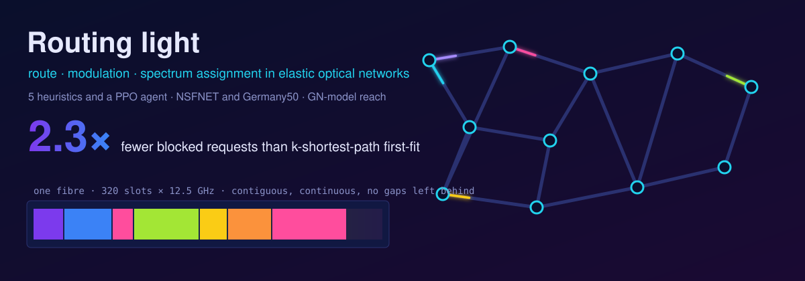
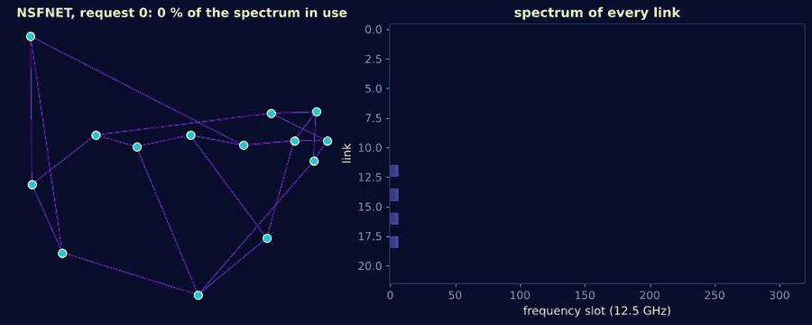
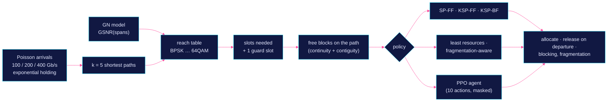
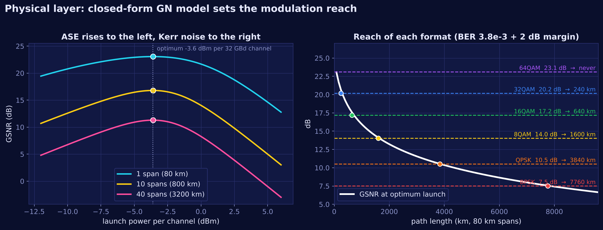
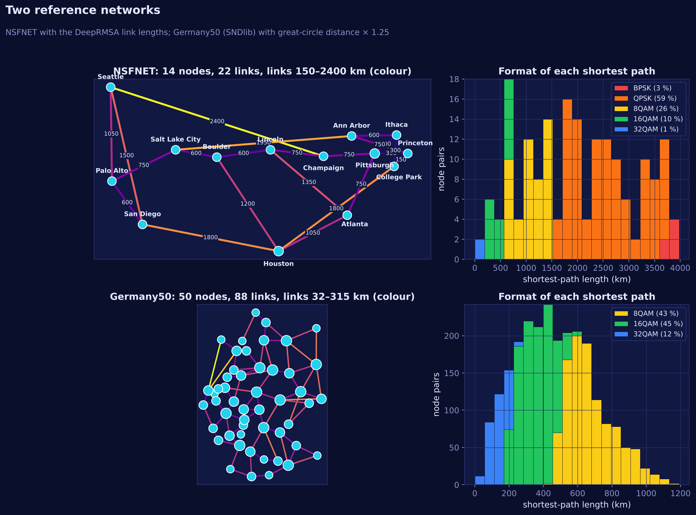
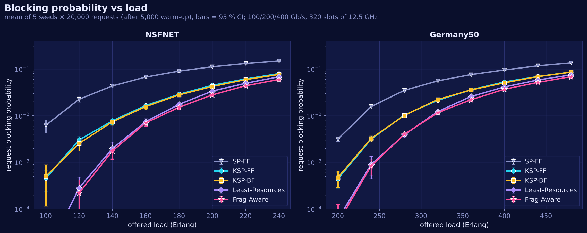
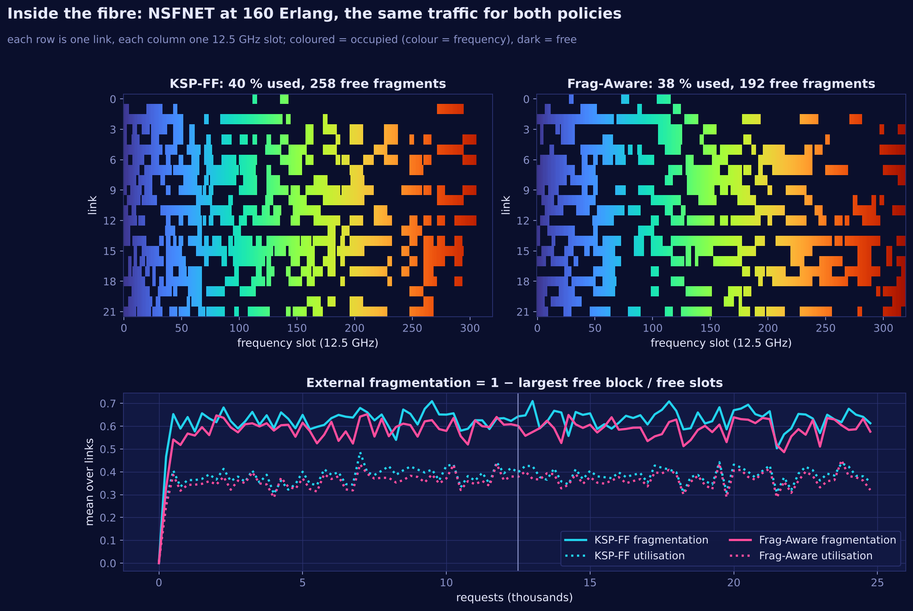
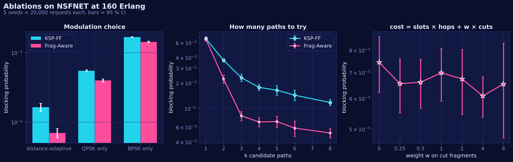
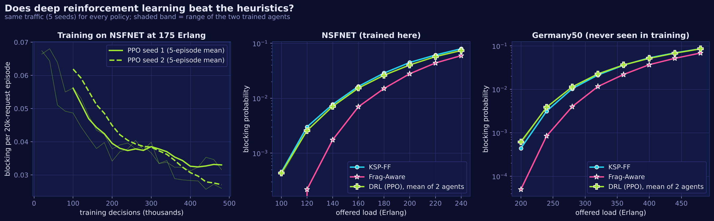
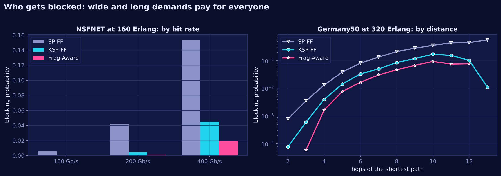

<p align="center"></p>

<p align="center">


</p>

<h3 align="center">Every new connection in an optical backbone needs a route, a modulation format<br>and a block of spectrum that is free on every fibre along the way. Choose badly and the spectrum shatters.</h3>

**Elastic optical networks (EONs)** cut the C-band into 12.5 GHz slots instead of the old fixed 50 GHz grid, so a 100 Gb/s demand can take 3 slots and a 400 Gb/s demand 12. The price is a hard online puzzle, **routing, modulation and spectrum assignment (RMSA)**:

* **Route:** which of the *k* shortest paths?
* **Modulation:** the highest-order format whose optical reach covers that path. 16QAM needs fewer slots than QPSK but dies after 640 km.
* **Spectrum:** a block of contiguous slots, the same block on every link of the path. Every allocation and release leaves gaps that may be too small for the next demand.

This repository builds an event-driven EON simulator from scratch: a closed-form GN-model physical layer, two real topologies (NSFNET with the DeepRMSA lengths, and Germany50 from SNDlib), five heuristics and a deep-reinforcement-learning agent (PPO in PyTorch). It answers which choices matter, by how much, and whether the neural network earns its place.

<table>
<tr>
<td align="center" width="25%"><h2>2.3×</h2><sub>fewer blocked requests than<br>k-shortest-path first fit (NSFNET,<br>160 Erlang: 0.70 % vs 1.64 %)</sub></td>
<td align="center" width="25%"><h2>10×</h2><sub>more blocking if every path<br>is forced to BPSK instead of<br>distance-adaptive formats</sub></td>
<td align="center" width="25%"><h2>3 840 km</h2><sub>QPSK reach from the GN model;<br>16QAM 640 km, 64QAM never<br>(25 dB transceiver ceiling)</sub></td>
<td align="center" width="25%"><h2>2×</h2><sub>more blocking from the PPO agent<br>than the fragmentation-aware<br>heuristic: it learns first fit, not more</sub></td>
</tr>
</table>

<p align="center"></p>
<p align="center"><sub>NSFNET at 160 Erlang under the fragmentation-aware policy, from an empty network to steady state. Left: link thickness and colour show the share of slots in use. Right: every link (row) over its 320 slots (columns); coloured = occupied.</sub></p>

---

## ▲ Run it

```bash
pip install numpy scipy networkx matplotlib torch
python experiments/train_drl.py         # two PPO agents, ~8 min each on one CPU core
python experiments/run_all.py           # all experiments and figures (~1.5 h on 2 cores)
python experiments/run_all.py physics maps blocking   # or only some
python -m pytest tests                  # 6 tests
```

Everything is seeded. [`results/`](results) holds every number behind every figure (CSV and JSON), including the per-seed raw results.



## ▲ Physical layer: how far each format reaches

<p align="center"></p>

Every lightpath is assumed to see a fully loaded 4 THz C-band (worst case). The closed-form GN model gives the nonlinear noise per 80 km span, $P_{\mathrm{NLI}} = \eta P^3$ with

$$\eta = \frac{8}{27}\,\frac{\gamma^2 L_{\mathrm{eff}}^2}{\pi\,|\beta_2|\,L_a\,R_s^2}\,\operatorname{asinh}\!\left(\frac{\pi^2}{2}|\beta_2| L_a B^2\right),\qquad L_a=\frac{1}{2\alpha}$$

and the optimum launch power $P^\ast = (P_{\mathrm{ASE}}/2\eta)^{1/3}$, here **−3.6 dBm per 32 GBd channel**. A 25 dB transceiver ceiling is added in parallel. A format is allowed if the GSNR beats the SNR for pre-FEC BER 3.8 × 10⁻³ plus a 2 dB margin:

| Format | Bits/symbol | SNR needed (+2 dB) | Reach | Slots for 100 / 200 / 400 Gb/s |
|:--|--:|--:|--:|:--:|
| BPSK | 1 | 7.5 dB | 7 760 km | 7 / 12 / 23 |
| QPSK | 2 | 10.5 dB | 3 840 km | 4 / 7 / 12 |
| 8QAM | 3 | 14.0 dB | 1 600 km | 3 / 5 / 9 |
| 16QAM | 4 | 17.2 dB | 640 km | 3 / 4 / 7 |
| 32QAM | 5 | 20.2 dB | 240 km | 3 / 4 / 6 |
| 64QAM | 6 | 23.1 dB | never | 2 / 3 / 5 |

Fibre: 0.2 dB/km, γ = 1.3 /W/km, D = 17 ps/nm/km, NF 5 dB. Slots include one guard slot.

## ▲ Two networks

<p align="center"></p>

* **NSFNET** (14 nodes, 22 links, 150–2400 km): a continental network. Most shortest paths need QPSK (59 %) or 8QAM (26 %).
* **Germany50** (50 nodes, 88 links, 32–315 km): a dense national network. Paths are short enough for 8QAM (43 %), 16QAM (45 %) and even 32QAM (12 %).

## ▲ Results

### 1 · Blocking probability against load

<p align="center"></p>

5 seeds × 20 000 requests per point after 5 000 warm-up requests; 95 % confidence intervals.

| NSFNET, request blocking | 120 E | 160 E | 200 E | 240 E |
|:--|--:|--:|--:|--:|
| SP-FF (shortest path, first fit) | 2.24 % | 6.70 % | 11.2 % | 14.9 % |
| KSP-FF (5 paths, first fit) | 0.30 % | 1.64 % | 4.47 % | 7.95 % |
| KSP-BF (5 paths, best fit) | 0.25 % | 1.56 % | 4.22 % | 7.63 % |
| Least resources (slots × hops) | 0.03 % | 0.74 % | 3.36 % | 6.79 % |
| **Fragmentation-aware** | **0.02 %** | **0.70 %** | **2.79 %** | **5.95 %** |

| Germany50, request blocking | 240 E | 320 E | 400 E | 480 E |
|:--|--:|--:|--:|--:|
| SP-FF | 1.56 % | 5.56 % | 9.50 % | 13.5 % |
| KSP-FF | 0.31 % | 2.13 % | 5.28 % | 8.56 % |
| KSP-BF | 0.32 % | 2.21 % | 5.06 % | 8.53 % |
| Least resources | 0.09 % | 1.22 % | 4.13 % | 7.45 % |
| **Fragmentation-aware** | **0.08 %** | **1.16 %** | **3.68 %** | **6.84 %** |

* Trying more than one path is the first big step: SP-FF blocks 1.6 to 8 times more than KSP-FF (most at light load).
* The second step is **choosing the path that uses the fewest slot-links** (slots × hops) instead of the first path that fits. That is where most of the gain lies: up to 10× fewer blocked requests at low load.
* Placing the block flush against occupied spectrum (fragmentation-aware) removes another 8–17 % of the blocking at high load.
* Best fit is barely better than first fit.

### 2 · Inside the fibre

<p align="center"></p>

Same traffic, same instant: KSP-FF uses 40 % of the spectrum and leaves 258 separate free fragments; the fragmentation-aware policy uses 38 % and leaves 192. Lower utilisation for more carried traffic: shorter paths and fewer, larger holes.

### 3 · What matters: modulation, path count, weight

<p align="center"></p>

NSFNET at 160 Erlang, 5 seeds:

* **Modulation:** forcing QPSK everywhere raises blocking from 1.6 % to 5.5 % (KSP-FF), and BPSK everywhere to 16.7 %. Distance-adaptive modulation is worth more than any spectrum trick.
* **Paths:** going from 1 to 3 candidate paths cuts fragmentation-aware blocking from 6.6 % to 0.8 %; beyond 4 paths the gain is small (0.5 % at k = 8).
* **Weight w on cut fragments:** every value from 0 to 8 gives 0.61–0.74 %, inside each other's confidence intervals. With edge placement and the slots × hops cost, the explicit fragment penalty adds nothing measurable here.

### 4 · Does a deep-learning agent beat the heuristics?

<p align="center"></p>

A DeepRMSA-style agent ([`drl.py`](eon/drl.py)): for each of the 5 candidate paths it sees 13 numbers (reach and feasibility, hops, length, format, slots needed, free spectrum, how many blocks fit and the largest, plus two candidate placements: first fit and the in-path placement that cuts fewest fragments, each with its start slot and cut count). It chooses one of 10 actions; infeasible ones are masked. Reward: +1 for each request placed, −1 for each request blocked before its next decision. PPO, two hidden layers of 128, two independent agents with 0.5 M training decisions each (about 8 minutes on one CPU core).

| Blocking | NSFNET 140 E | NSFNET 180 E | NSFNET 220 E | Germany50 280 E | Germany50 360 E | Germany50 440 E |
|:--|--:|--:|--:|--:|--:|--:|
| KSP-FF | 0.77 % | 2.87 % | 6.11 % | 1.03 % | 3.58 % | 6.89 % |
| **PPO agent** (mean of 2) | 0.71 % | 2.62 % | 5.72 % | 1.14 % | 3.63 % | 6.80 % |
| Fragmentation-aware heuristic | **0.17 %** | **1.50 %** | **4.37 %** | **0.40 %** | **2.19 %** | **5.16 %** |

* The agent learns. Its training blocking falls from 6.5 % to 2.7–3.3 %, and on NSFNET it ends **5–10 % below KSP-FF**. The two agents agree to within 0.1 point.
* It does **not** reach the heuristic, which blocks 1.3 to 4 times fewer requests at the same load (the gap is widest at light load). The agent settles on what is essentially first fit on the shortest feasible path, with a slight preference for less fragmented placements.
* Moved to Germany50 without retraining, it behaves the same way: equal to KSP-FF, never better than the heuristic.
* Longer training, reward shaping or richer features might close the gap; this repository reports what a faithful, modest-budget DeepRMSA setup gives. **A well-chosen cost function (slots × hops, flush placement) is still the stronger baseline, and any learned RMSA should be compared against it, not only against KSP-FF.**

### 5 · Who gets blocked

<p align="center"></p>

Blocking is not shared fairly. On NSFNET at 160 Erlang a 400 Gb/s demand is blocked **4.5 % of the time with KSP-FF and 2.0 % with the fragmentation-aware policy, while 100 Gb/s demands almost never are**: a wide demand needs a wide hole. On Germany50, demands between distant nodes (10+ hops) are blocked tens of times more often than neighbours. Any operator that sells 400G services needs to plan for this.

## ▲ Model and limits

* Fully loaded, worst-case GN model per path; no per-lightpath QoT check against its actual neighbours, no filter penalties at the nodes.
* Uniform traffic between all node pairs; 100 / 200 / 400 Gb/s with equal probability; no re-optimisation or defragmentation of live connections.
* Germany50 link lengths are great-circle distances × 1.25 (fibre does not run straight).
* The PPO agent uses topology-agnostic features (per-path summaries), so the same network runs on any topology with *k* = 5 paths.

## ▲ Repository map

```
elastic-optical-network-rsa/
├── eon/
│   ├── physics.py        GN model, reach table, slots per demand
│   ├── topology.py       NSFNET, Germany50, k shortest paths
│   ├── sim.py            event-driven simulator, spectrum state, metrics
│   ├── policies.py       SP-FF, KSP-FF, KSP-BF, least resources, fragmentation-aware
│   └── drl.py            RMSA environment, actor-critic, PPO, evaluation
├── experiments/
│   ├── train_drl.py      trains two PPO agents
│   ├── run_all.py        every experiment and figure
│   ├── make_gif.py       the spectrum animation
│   └── style.py
├── topologies/           nsfnet_chen.txt, germany50.xml (from optical-rl-gym, MIT)
├── models/               trained PPO weights
├── tests/                6 tests
├── figures/  results/  assets/
```

## ▲ References

1. X. Chen *et al.*, "DeepRMSA: A deep reinforcement learning framework for routing, modulation and spectrum assignment in elastic optical networks," *J. Lightwave Technol.*, vol. 37, no. 16, 2019.
2. P. Poggiolini, "The GN model of non-linear propagation in uncompensated coherent optical systems," *J. Lightwave Technol.*, vol. 30, no. 24, 2012.
3. B. C. Chatterjee, N. Sarma, E. Oki, "Routing and spectrum allocation in elastic optical networks: a tutorial," *IEEE Commun. Surveys & Tutorials*, vol. 17, no. 3, 2015.
4. C. Natalino, P. Monti, "The optical RL-gym: an open-source toolkit for applying reinforcement learning in optical networks," *ICTON*, 2020 (source of the topology files).
5. S. Orlowski *et al.*, "SNDlib 1.0 — Survivable network design library," *Networks*, vol. 55, no. 3, 2010 (Germany50).
6. J. Schulman *et al.*, "Proximal policy optimization algorithms," arXiv:1707.06347, 2017.

## ▲ Licence

MIT © Eng. Jaafar Salim. The topology files in `topologies/` come from [optical-rl-gym](https://github.com/carlosnatalino/optical-rl-gym) (MIT); Germany50 originates from SNDlib.
